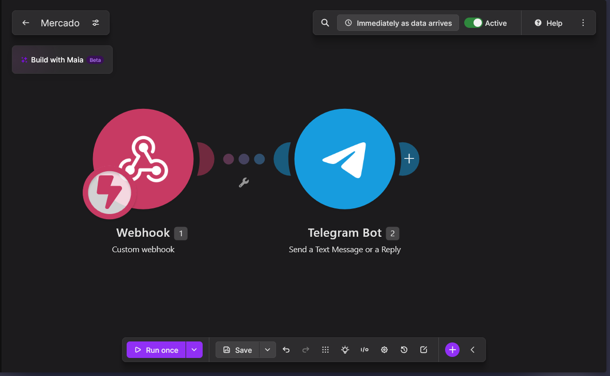
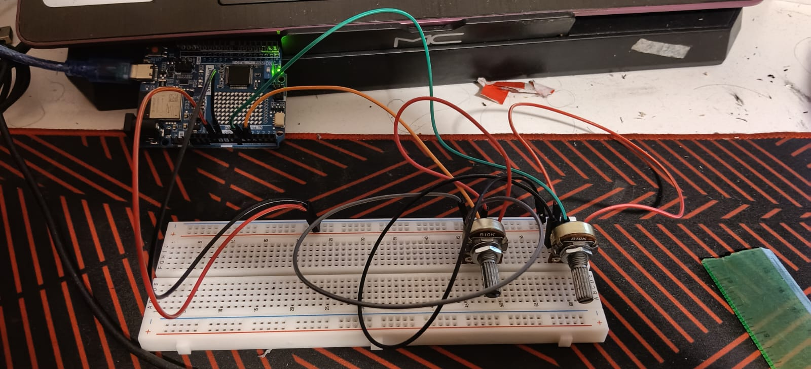
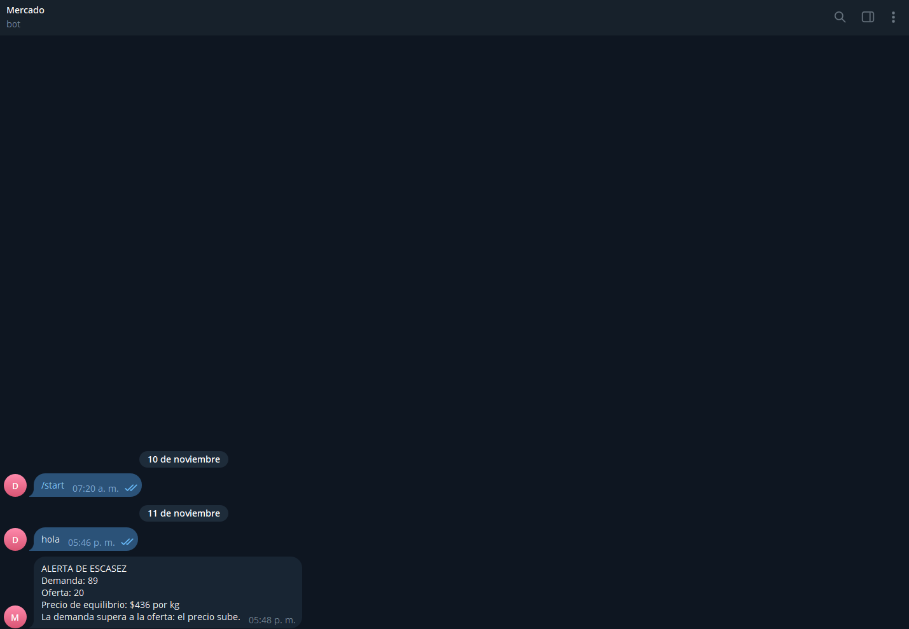

# Simulador de oferta y demanda

## Descripción

Se realizó una práctica en la que se construyó un simulador físico de oferta y demanda del kilo de camarón y una automatización en Make. Dos potenciómetros representan la demanda y la oferta; el Arduino UNO R4 WiFi lee ambos valores, calcula el precio de equilibrio con un modelo lineal y lo muestra en su matriz LED. Cuando la demanda supera a la oferta por 25 puntos o más (escasez), el Arduino envía los datos a un webhook de Make, que manda una alerta de escasez a Telegram mediante un bot creado con BotFather. Para no gastar créditos de Make, el código envía una alerta solo cuando el mercado pasa a escasez y como máximo una por minuto.

Flujo: Potenciómetros → Arduino UNO R4 WiFi (calcula y muestra el precio) → Webhook de Make → Telegram (alerta de escasez)

Escenarios simulados: temporada normal, veda de camarón, Semana Santa (alta demanda), sobreproducción de granjas y huracán que cierra la pesca.

## Objetivos de aprendizaje

- Explicar cómo la oferta y la demanda fijan los precios y relacionar la escasez de un recurso natural con su precio.
- Construir un sistema IoT que convierta un fenómeno económico en datos y alertas automáticas.

## Material utilizado

- Arduino UNO R4 WiFi con cable USB-C
- 2 potenciómetros de 10 kΩ, protoboard y cables jumper
- Computadora con Arduino IDE y las librerías ArduinoGraphics y Arduino_LED_Matrix
- Red WiFi de 2.4 GHz con usuario y contraseña
- Make (cuenta del curso, módulo Webhooks)
- Telegram (bot creado con BotFather)
- GitHub

## Investigación previa

- Definición de oferta, demanda y precio de equilibrio (con fuente).
- Qué es una veda y por qué se aplica a la pesca de camarón en el Pacífico mexicano.
- Dos ejemplos reales de Sinaloa en los que la escasez de un producto subió su precio.

## Resultados

### Experimentos de mercado

| Escenario | Demanda | Oferta | Precio ($/kg) | ¿Alerta? | Explicación económica |
| --- | --- | --- | --- | --- | --- |
| Temporada normal | $45 | $45 | $300 | No | El mercado mantiene un flujo constante de producto de altamar, bahía y granja sin presiones externas. |
| Veda de camarón | $45 | $90 | $208 | No | Se prohíbe la captura silvestre para proteger la reproducción, dejando solo inventario congelado o de granja. |
| Semana Santa (alta demanda) | $90 | $45 | $388 | Si | El consumo se dispara por tradiciones religiosas y turismo, superando la disponibilidad inmediata. |
| Sobreproducción de granjas | $45 | $90 | $208 | No | Las cosechas acuícolas inundan el mercado al mismo tiempo, obligando a los productores a bajar precios para vender rápido. |
| Huracán que cierra la pesca | $25 | $10 | $328 | Si | Los puertos cierran por seguridad y se interrumpe la cadena de frío, generando escasez repentina en puntos de venta. |

### Preguntas del informe

1. ¿Por qué el precio sube cuando la oferta baja, aunque el producto sea el mismo?
2. Una veda reduce la oferta y sube el precio. ¿Por qué aun así conviene para la economía de largo plazo?
3. ¿Qué factores reales de la oferta de camarón no considera el modelo (clima, costos de combustible, importaciones)?
4. ¿Qué ventaja tiene automatizar una alerta de escasez para un productor o una cooperativa?
5. ¿El precio de mercado incluye el costo ambiental de producir el camarón?

## Diagrama

## Código

- [Código del Arduino (.ino)](Codigo/Mercado.ino)
- [Blueprint del escenario de Make](Codigo/Mercado.blueprint.json)

## Video del funcionamiento

[Carpeta](Video/README.md)
[Simulador de oferta y demanda: explicación con Make y Arduino](https://youtu.be/o87KjXfc70o)

## Evidencia

### Foto 1 (Circuito armado)

### Foto 2 (Escenario en Make)

### Foto 3 (Alerta de escasez en Telegram)

### Foto 4 (Precio en la matriz LED y Monitor Serie)

## Conclusiones

La práctica permitió construir un sistema IoT que convierte un fenómeno económico en datos y alertas automáticas. Comprobamos cómo el precio de equilibrio cambia al mover la oferta y la demanda, y cómo la escasez, por ejemplo por una veda o un huracán, hace que el precio suba. También se reforzó el conocimiento sobre cómo conectar un Arduino a un webhook de Make y cómo enviar alertas a Telegram, cuidando el token del bot y limitando el número de alertas para no gastar créditos. Conocemos de antemano que el modelo es una simplificación, porque no considera factores reales como el clima, el costo del combustible o las importaciones ni el costo ambiental de producir el camarón.
