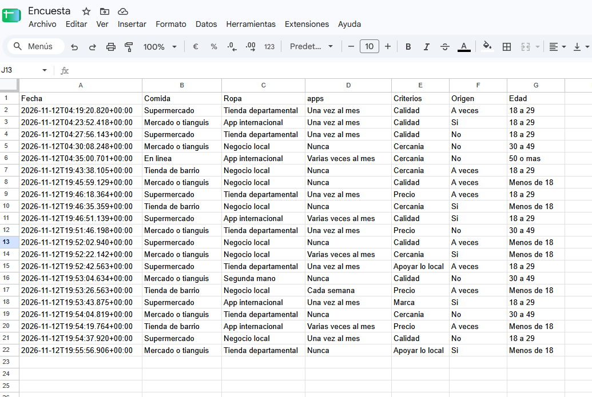
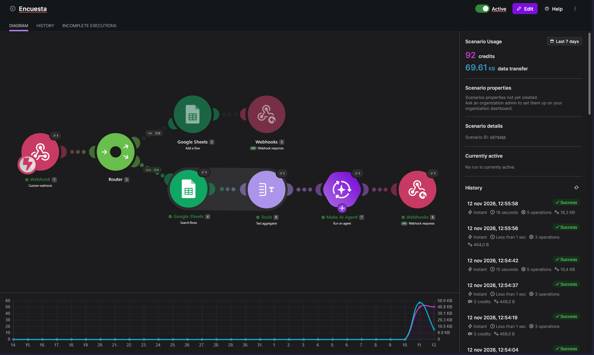
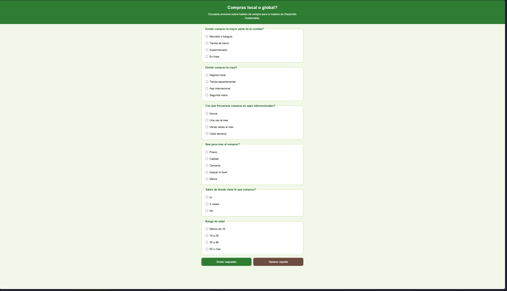
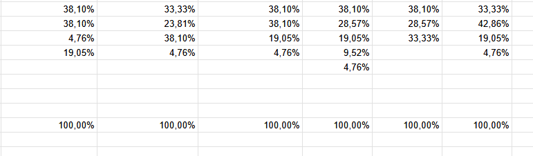

# Encuesta "¿Compras local o global?"

## Descripción

Se realizó una práctica en la que se construyó una página web llamada "Compras local o global?" y una automatización en Make. En la página el usuario contesta una encuesta anónima de seis preguntas sobre sus hábitos de compra (comida, ropa, apps internacionales, criterio de compra, origen de lo que compra y rango de edad) y presiona "Enviar respuesta"; la página envía los datos a un webhook de Make, que con un Router guarda cada respuesta en una hoja de Google Sheets. Con un botón aparte, "Generar reporte", la página envía otra acción al mismo webhook: Make lee todas las respuestas de la hoja, las junta en un solo texto con un Text aggregator, un Make AI Agent las analiza y regresa una respuesta en texto plano con el total de respuestas, los porcentajes de cada pregunta, un análisis de qué tan local o global es el consumo de la comunidad y tres conclusiones (efecto en la economía local, efecto ambiental por transporte y empaques, y una acción concreta para impulsar el consumo local).

Flujo: Página web → Make (Webhooks → Router → Ruta 1: Google Sheets Add a Row → Webhook Response / Ruta 2: Google Sheets Search Rows → Text aggregator → Make AI Agent → Webhook Response) → Página web

Preguntas de la encuesta: dónde compra su comida, dónde compra su ropa, frecuencia de compra en apps internacionales, qué pesa más al comprar, si sabe de dónde viene lo que compra y rango de edad.

## Objetivos de aprendizaje

- Identificar los hábitos de compra local y global de la comunidad y relacionarlos con la economía regional y el PIB.
- Construir sin programar un sistema de encuesta que guarde las respuestas en Google Sheets y genere un reporte automático con IA.
- Verificar que los porcentajes generados por la IA sean correctos comparándolos con fórmulas de Sheets (COUNTIF).

## Material utilizado

- Computadora y celular con navegador
- Make (plan Pro del curso, conexión Make's AI Provider)
- Cuenta de Google (Google Sheets)
- IA generativa (versión gratuita) para generar la página
- GitHub y GitHub Pages
- 20 personas para encuestar (sin registrar nombres)

## Resultados Act8

## Diagrama

## Código

- [index.html (página web)](Codigo/index.html)
- [Blueprint del escenario de Make](Codigo/Encuesta.blueprint.json)

Página publicada: [https://darkmagicyt.github.io/DesarrolloSustentable/4.2/Codigo/index.html](https://darkmagicyt.github.io/DesarrolloSustentable/4.2/Codigo/index.html)

## Video del funcionamiento

[Carpeta](Video/README.md)
[Encuesta: funcionamiento con Make y página web](https://youtu.be/KMVlPhui7L0)

## Evidencia

### Foto 1 (Escenario en Make)

### Foto 2 (Página web publicada)

### Foto 3 (Respuestas guardadas en Google Sheets)

### Foto 4 (Verificación de porcentajes con COUNTIF)

## Conclusiones

La práctica permitió construir un sistema de encuesta con análisis automático sin programar el procesamiento de la información. A su vez comprobamos que los porcentajes del reporte concordaran con los que calculamos en Google Sheets con la fórmula COUNTIF, conociendo de antemano que la IA puede cometer errores al contar. Se reforzó el conocimiento sobre como conectar un webhook a una página web, como usar un Router con filtros para separar dos acciones en un mismo escenario y como guardar y leer datos de Google Sheets desde Make. También se relacionaron los hábitos de compra de la comunidad con la economía local, el PIB y el impacto ambiental del transporte y los empaques.
