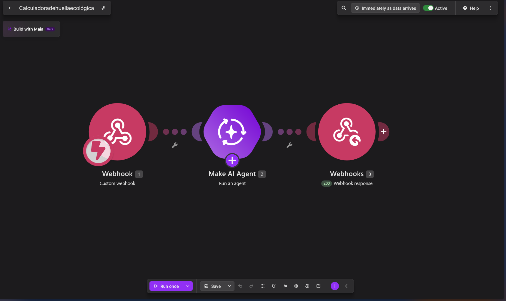
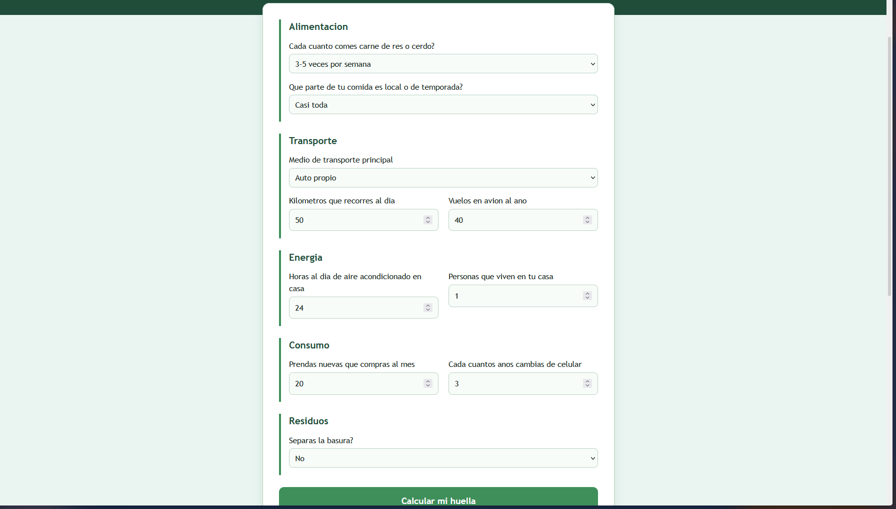
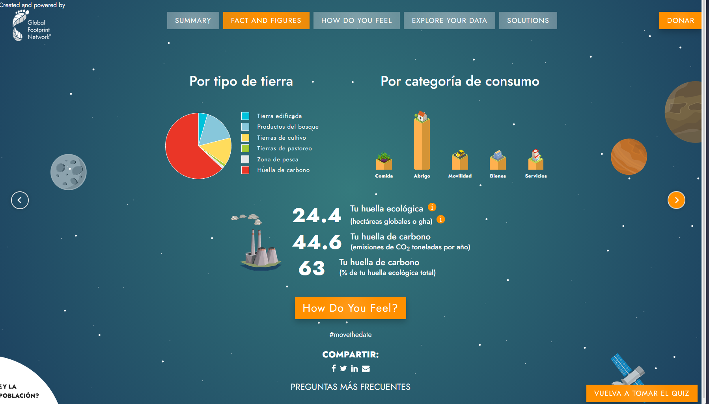

# Calculadora de huella ecológica: Página web y Make

## Descripción

Se realizó una práctica en la que se construyó una página web llamada "Calculadora de huella ecológica" y una automatización en Make. En la página el usuario contesta un cuestionario de diez preguntas sobre alimentación, transporte, energía, consumo y residuos y presiona "Calcular mi huella"; la página envía las respuestas a un webhook de Make, donde un Make AI Agent estima la huella ecológica de la persona y regresa una respuesta en texto plano con las hectáreas globales por año, los planetas necesarios si todos vivieran así, el impacto por área, tres acciones para reducirla y una oportunidad económica sustentable de la región. Después, cada integrante comparó el resultado de la página con el de la calculadora oficial de Global Footprint Network.

Flujo: Página web → Make (Webhooks → Make AI Agent → Webhook Response) → Página web

Preguntas del cuestionario: carne, comida local, medio de transporte, kilómetros al día, vuelos al año, horas de aire acondicionado, personas en casa, ropa nueva al mes, cambio de celular y separación de basura.

## Objetivos de aprendizaje

- Calcular y comparar la huella ecológica personal e identificar qué hábitos la elevan.
- Construir sin programar una herramienta que reciba datos desde una página web, los procese con IA y muestre el resultado.
- Evaluar la precisión de una estimación hecha con IA al compararla con la calculadora oficial de Global Footprint Network.
- Proponer estrategias económicas y personales para reducir la huella ecológica.

## Material utilizado

- Computadora con navegador
- Make (plan Pro del curso, conexión Make's AI Provider, sin API key)
- IA generativa (versión gratuita) para generar la página
- GitHub y GitHub Pages
- Calculadora oficial de Global Footprint Network ([footprintcalculator.org](https://www.footprintcalculator.org))

## Resultados

| Encuestado | Planetas según su página | Planetas según la calculadora oficial | Diferencia | Área de mayor impacto |
| --- | --- | --- | --- | --- |
| 1 | 4.5 | 4.9 | 0.4 | Comida |
| 2 | 1.2 | 4.1 | 3.9 | Movilidad |
| 3 | 2 | 5.7 | 3.7 | Abrigo |
| 4 | 1.8 | 14.3 | 12.5 | Abrigo |

## Diagrama

## Código

- [index.html (página web)](Codigo/index.html)
- [Blueprint del escenario de Make](Codigo/Calculadoradehuellaecológica.blueprint.json)

Página publicada: [[https://darkmagicyt.github.io/DesarrolloSustentable/4.5/Codigo/index.html](https://darkmagicyt.github.io/DesarrolloSustentable/4.5/Codigo/index.html)]

## Video del funcionamiento

[Carpeta](Video/README.md)
[Calculadora de huella ecológica: funcionamiento](https://youtu.be/w7N3uDykccU)

## Evidencia

### Foto 1 (Escenario en Make)

### Foto 2 (Página web publicada)

### Foto 3 (Calculadora Oficial)

## Conclusiones

La práctica permitió construir una calculadora de huella ecológica sin programar el procesamiento de la información. A su vez comparamos la estimación de la IA con la calculadora oficial de Global Footprint Network, conociendo de antemano que la IA da un valor aproximado y puede tener diferencias por falta de contexto o por los pocos datos que se le envían. Se reforzó el conocimiento sobre cómo conectar un webhook a una página web y sobre la importancia de enviar los datos como formulario y de agregar el encabezado Access-Control-Allow-Origin en la respuesta para que el navegador la acepte. También se identificó qué hábitos aumentan la huella, como el uso del aire acondicionado en el clima de Mazatlán, y se propusieron acciones y oportunidades económicas sustentables para reducirla.
